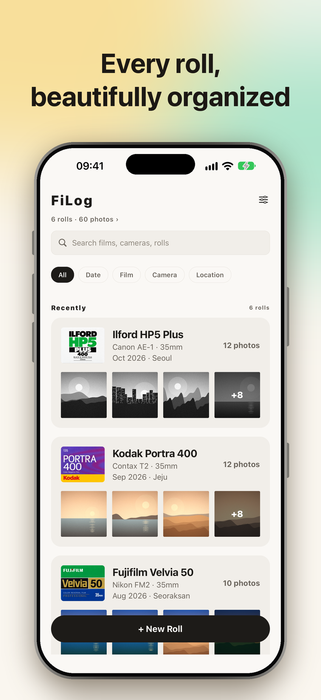
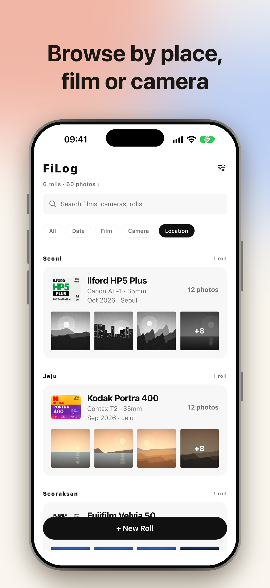
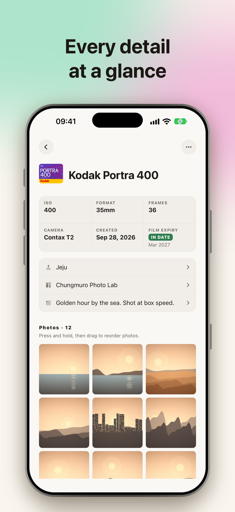
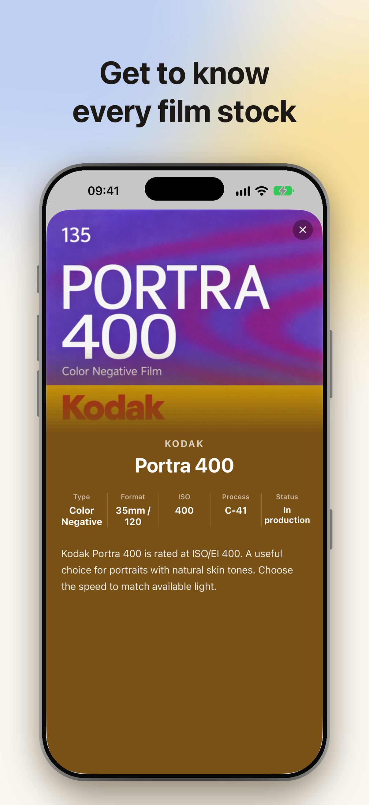
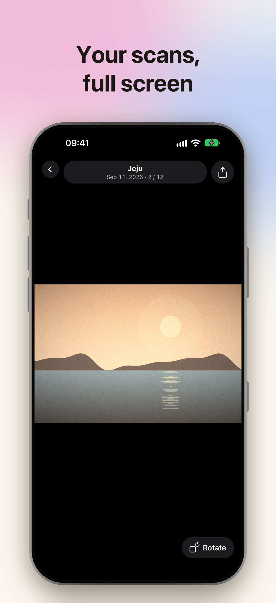
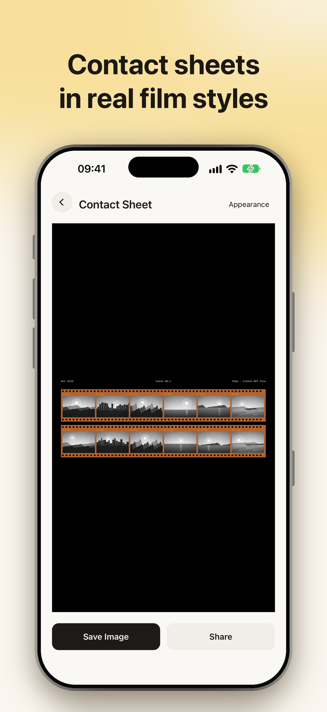
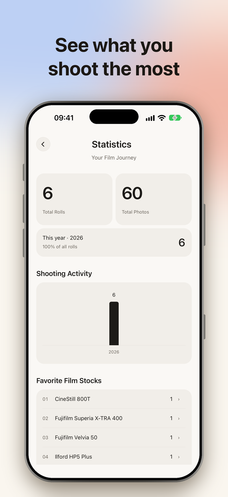
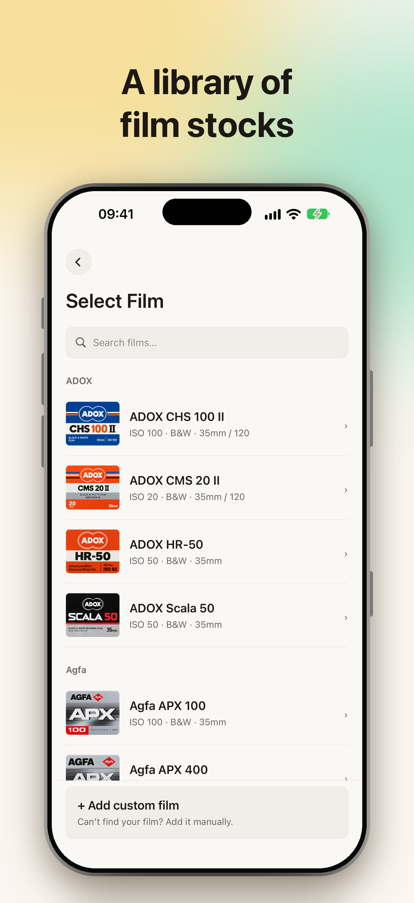

# FiLog

**A logbook for film photographers.**

FiLog keeps the story behind every roll — film stock, camera, place and date — together with your scans, organized on your iPhone. No account, no ads, no tracking: your data stays on your device and in your own iCloud.

<p align="center">
  
  
  
  
</p>
<p align="center">
  
  
  
  
</p>

**Current beta: version 1.0.0 (build 4)** — see [What's new](#whats-new-in-build-4).

## Features

**Log every roll**
- Film stock, camera, format (35mm / 120 / 110), frame count, shooting month, lab and notes
- Film expiry month with an automatic **In date** / **Outdate** badge, plus the date each roll was created
- A spec card on every roll, and a compact header that stays pinned while you browse its photos
- A built-in library of 269 film stocks with package covers, plus your own films and cameras
- Tap any film cover for its introduction page: type, format, ISO, process, production status and a short description, tinted to the cover's colors
- Custom covers are cropped to a fixed ratio; an optional "copy prompt" helps you create one with ChatGPT (nothing is sent automatically)

**Your scans, linked — not copied**
- Add scans straight from Apple Photos; originals stay where they are and use no extra storage
- Drag frames into order, add a note, date and place per frame, browse full-screen

**Find any frame**
- Search everything, or group rolls by date, film, camera or location
- Pin where each roll was shot on a map

**Relive and share**
- Statistics: your most-shot films, cameras and places, and activity over time
- Export a classic contact sheet with 11 frame styles (film strips, color and B&W negatives, 120 edges, instant prints…) and 8 backgrounds, including any custom color

**iCloud sync and restore**
- Turn on **Settings → iCloud Sync** (off by default) and your rolls sync through your private iCloud (CloudKit); they are restored automatically after reinstalling or on a new iPhone

**Built for everyone**
- English, Tiếng Việt and 한국어 · Light, Dark or **System** appearance with a warm, high-contrast palette (WCAG AA) · VoiceOver labels
- Free, with no ads or subscriptions. Optional tips to support development are planned for a later update.

## What's new in build 4

- Tips are switched off for the first App Store release; they return in 1.0.1.

### Build 3

- **Film info pages** — tap a film cover in the film picker or on a roll to read about that stock.
- **Film expiry** — record the date on the box; rolls show an In date or Outdate badge automatically.
- **Roll details redesigned** — spec card, icon list for place, lab and notes, creation date, and a header pinned while scrolling photos.
- **Contact sheets** — new frame styles and backgrounds.
- **Appearance** — new System option (now the default), refreshed light and dark palettes, clearer form fields.
- **iCloud Sync** is off on a fresh install; turn it on in Settings to back up and restore.
- Fixes: photos no longer flash all at once when the Photos library changes; tidier back and options buttons.

## Install the beta with TestFlight

FiLog is in beta on Apple TestFlight. You need an **iPhone running iOS 16.4 or later**.

1. Install **[TestFlight](https://apps.apple.com/app/testflight/id899247664)** from the App Store and sign in with your Apple ID.
2. Join the beta:
   - **Public link:** open **[testflight.apple.com/join/nVkaZtC4](https://testflight.apple.com/join/nVkaZtC4)** on your iPhone, then tap **Accept** → **Install**.
   - **Team members (internal testers):** accept the email invitation from TestFlight, or ask the maintainer to add your Apple ID under *Internal Testing*.
3. Open **FiLog** from your Home Screen. The first launch shows a short guide through New Roll, Browse, Statistics and Settings.

**Good to know**
- Each beta build expires after 90 days. TestFlight notifies you when a new build is ready — tap **Update**.
- Updating from TestFlight, or later moving to the App Store release, keeps your rolls.
- To try iCloud restore: turn on **Settings → iCloud Sync**, wait for it to finish, delete the app, then reinstall from TestFlight — your rolls come back automatically. Photos linked from Apple Photos are never deleted by FiLog.

**Send feedback:** take a screenshot while using FiLog and tap **Share Beta Feedback**, or open TestFlight → FiLog → **Send Beta Feedback**. You can also email bean272003@gmail.com.

## Privacy

FiLog collects no data. There is no account, no analytics and no developer server: rolls live on your iPhone and, if you turn on sync, in your own iCloud. Photos are read only when you pick them. See the [privacy policy](https://duongbean.github.io/filog-legal/privacy.html) and [support page](https://duongbean.github.io/filog-legal/support.html).

## Development

**Requirements:** macOS with Xcode (current builds use Xcode 27), Node.js 20+, CocoaPods and an iOS 16.4+ simulator or device.

```bash
npm install
cd ios && pod install && cd ..
open ios/FiLog.xcworkspace   # build and run the FiLog scheme
```

`ios/` is maintained native source (custom AppDelegate, signing, entitlements and a local Expo module). Do **not** run `expo prebuild --clean`; see [docs/NATIVE_CONFIGURATION.md](docs/NATIVE_CONFIGURATION.md).

| Command | What it does |
|---|---|
| `npm test` | Unit and integration tests (Node test runner) |
| `npm run typecheck` | TypeScript, no emit |
| `npm run lint` | ESLint for `app/` and `src/` |
| `npm run check:ios-config` | Checks bundle ID, permissions, scheme and entitlements stay consistent |

### Tech stack

| Area | Technology |
|---|---|
| App | React Native 0.86 + Expo 57, TypeScript |
| Navigation | Expo Router (file-based routes in `app/`) |
| State | Zustand stores per feature |
| Storage | `expo-sqlite` key-value store; app-owned files in Documents |
| Photos | Local Expo module `modules/filog-photos` (PhotoKit references, rendering, cropping) |
| Sync | CloudKit private database via the same native module |
| Tips | StoreKit 2 consumables (`ios/FiLog/FiLog.storekit` for local testing) |

### Project layout

```
app/                 Screens and routes (Expo Router)
src/features/        Feature modules: rolls, photos, films, cameras, catalog,
                     contact-sheet, cloud, settings, home, location, startup
src/components/ui/   Shared UI components
src/i18n/            English, Vietnamese and Korean strings
modules/filog-photos Native iOS module (Swift / Objective-C)
docs/                Release, privacy, sync and QA notes
```

### More documentation

- [App Store listing and review notes](docs/APP_STORE_LISTING.md)
- [Cloud sync design](docs/CLOUD_SYNC_PLAN.md) and [QA](docs/CLOUD_SYNC_QA.md)
- [Release readiness](docs/FILOG_RELEASE_READINESS.md)
- [User personas and stories](personas.md)
- [Figma design](https://www.figma.com/design/p87D59J5BkCPvYnHbt2P5s)

## About

FiLog is a Software Engineering course project (Group 11, Chungbuk National University), developed and published by duongbean.
