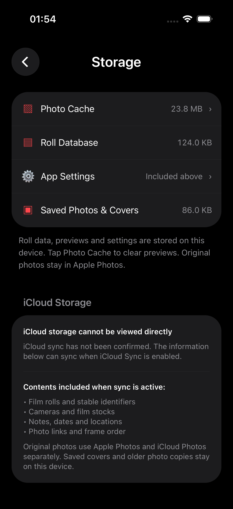
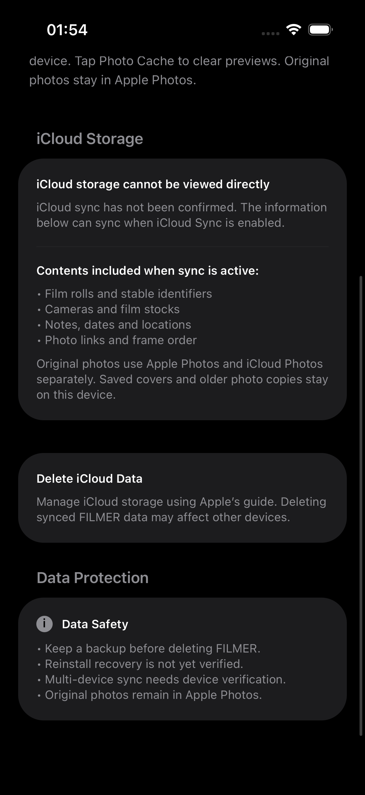

# Storage visual QA — 2026-10-22

Actual Simulator captures, iPhone 17, iOS 26.5, English, current unconfigured iCloud state. Captured by a passing temporary XCTest against the installed FILMER app; no fixture statistics or fabricated cloud-success state. The original FilmMeter screenshot is supplied in the chat and is the comparison reference; it is not available as a local image for an automated pixel diff.

| Reference element | FILMER result |
| --- | --- |
| Gray mixed-case iCloud Storage heading | Same hierarchy, left inset 20pt inside the page margin |
| Large charcoal rounded card | 28pt radius, 20pt inset, white semibold title, muted paragraph |
| Divider then bold subtitle and compact bullets | Hairline divider and four FILMER metadata bullets; subtitle conditional while sync is unverified |
| Separate Delete iCloud Data card | Larger gap, title/body, Apple guide link; no delete endpoint |
| Data Protection heading and one Data Safety card | Same hierarchy and four bullets; neutral info marker while device recovery remains unverified |
| Bottom navigation / safe area | FILMER keeps its existing stack navigation and bottom-safe scrolling; no FilmMeter tabs or branding copied |

Content-driven card heights differ because FILMER must disclose original-photo ownership and local-only covers/Copy files. Dynamic Type and translations may increase height; no fixed-height clipping. This is a visual comparison, not a claim of pixel-perfect automated matching.

## Top of Storage

## iCloud Storage through Data Protection

